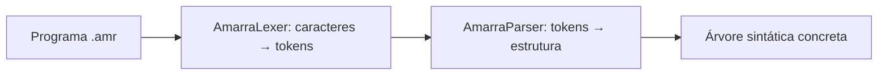
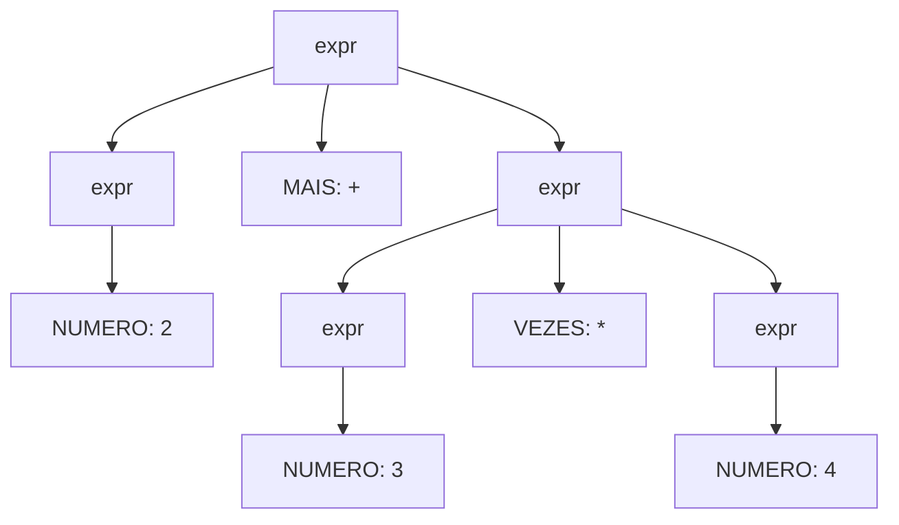

# Aula 10 aplicada à Amarra: árvore sintática

Esta implementação usa os conceitos apresentados em **Aula10 - Arvore
sintatica.pdf**, encontro de 30 de setembro, da disciplina Linguagens Formais e
Compiladores. Os exemplos abaixo foram adaptados ao domínio da Amarra.

## Do lexer ao parser



O lexer reconhece palavras-chave, identificadores, números, textos e delimitadores.
O parser verifica como esses tokens se organizam em declarações, comandos,
expressões e blocos. Por exemplo, `apertar` e `}` são tokens válidos, mas um bloco
com `apertar }` tem erro sintático porque falta o `;` depois do comando.

Em vez de reunir todas as regras em um único arquivo, mantivemos o lexer da E2
e acrescentamos `gramatica/AmarraParser.g4`. A opção `tokenVocab = AmarraLexer`
faz o parser usar o vocabulário já reconhecido pelo lexer.

## Vocabulário da aula no projeto

| Conceito | Aplicação na Amarra |
|---|---|
| Alfabeto | Caracteres usados nos programas: letras, dígitos, aspas, chaves, operadores e outros caracteres permitidos pelas regras léxicas. |
| Palavra | Uma sequência de caracteres que pode representar um programa inteiro. |
| Linguagem | Conjunto dos programas aceitos pelas regras da Amarra. |
| Gramática | Regras léxicas e sintáticas que definem a estrutura desses programas. |
| Produção | Uma regra, como `bloco : ABRE_CHAVE instrucao* FECHA_CHAVE ;`. |
| Terminal do parser | Um token já reconhecido pelo lexer, como `NO`, `IDENT`, `NUMERO` e `PONTOVIRG`. |
| Não terminal | Uma regra do parser, como `programa`, `bloco`, `instrucao` ou `expr`. |
| Derivação | Aplicação das produções para transformar o símbolo inicial em uma sequência de terminais. |

No ANTLR, as regras do parser começam com letra minúscula; os nomes dos tokens
começam com maiúscula. `IDENT` tem uma regra no **lexer**, mas é um terminal para
o **parser**: nessa etapa, ele já foi reconhecido.

## Regra inicial e derivação

```antlr
programa : definicaoNo+ EOF ;
definicaoNo : NO TEXTO bloco ;
bloco : ABRE_CHAVE instrucao* FECHA_CHAVE ;
```

`+` exige uma ou mais definições de nó; `*` permite zero ou mais instruções no
bloco. O `EOF` exige o fim do arquivo, impedindo que um programa seja aceito
apenas porque começa com um trecho válido.

Uma derivação para `no "simples" { apertar; }`, escolhendo uma definição e uma
instrução, é:

```text
programa
=> definicaoNo EOF
=> NO TEXTO bloco EOF
=> NO TEXTO ABRE_CHAVE instrucao FECHA_CHAVE EOF
=> NO TEXTO ABRE_CHAVE comando PONTOVIRG FECHA_CHAVE EOF
=> NO TEXTO ABRE_CHAVE APERTAR PONTOVIRG FECHA_CHAVE EOF
```

Na última linha, restam os tokens do programa e o marcador de fim. Os lexemas
concretos são `no`, `"simples"`, `{`, `apertar`, `;` e `}`.

## Recursão e aninhamento

```antlr
bloco : ABRE_CHAVE instrucao* FECHA_CHAVE ;
// Entre as alternativas de instrucao estao repeticao e condicional.
repeticao : REPETIR expr bloco ;
condicional : SE expr bloco ;
```

Um bloco pode conter uma repetição, que contém outro bloco, que pode conter uma
condicional. Essa recursão permite reconhecer estruturas como:

```amarra
no "reforco" {
    repetir 2 {
        se verdadeiro {
            apertar;
        }
    }
}
```

O parser reconhece a correspondência entre chaves e a estrutura de cada bloco.
Isso é diferente de apenas reconhecer `{` e `}` como tokens isolados.

## Árvore sintática concreta

Para `no "simples" { apertar; }`, a saída indentada é:

```text
programa
  definicaoNo
    NO 'no'
    TEXTO '"simples"'
    bloco
      ABRE_CHAVE '{'
      instrucao
        comando
          APERTAR 'apertar'
        PONTOVIRG ';'
      FECHA_CHAVE '}'
  EOF '<EOF>'
```

Os nós internos representam regras; as folhas representam tokens. Essa é a
**árvore sintática concreta** (*parse tree*) produzida pelo ANTLR: ela preserva
chaves, ponto e vírgula e os demais tokens. Uma árvore sintática abstrata (AST)
seria uma representação posterior, com detalhes sintáticos removidos.

## Precedência, associatividade e ambiguidade

Uma expressão como `2 + 3 * 4` admite interpretações diferentes se a gramática
não estabelecer precedência. Na Amarra, a multiplicação tem prioridade sobre a
soma. Este diagrama mostra o trecho da árvore correspondente à expressão:



As alternativas recursivas de `expr` estão ordenadas do grupo com maior
precedência para o de menor precedência: `* /`, `+ -`, `> < ==`, `e`, `ou`.
Há também alternativas para parênteses e menos unário, que têm prioridade sobre
esses grupos. Operadores do mesmo grupo associam à esquerda.

| Expressão | Agrupamento reconhecido |
|---|---|
| `2 + 3 * 4` | `2 + (3 * 4)` |
| `(2 + 3) * 4` | A soma entre parênteses é o operando esquerdo da multiplicação. |
| `-2 * 3` | `(-2) * 3` |
| `8 - 3 - 1` | `(8 - 3) - 1` |
| `voltas > 1 e verdadeiro ou falso` | `((voltas > 1) e verdadeiro) ou falso` |

Os testes verificam os nós e os filhos dessas árvores, para detectar uma mudança
acidental de precedência. Nesta fase, as expressões são analisadas, sem calcular
seus valores nem executar os movimentos.

## Executar e verificar

Na raiz do projeto, com as dependências instaladas:

**Windows — PowerShell**

```powershell
.\.venv\Scripts\python.exe gerar.py
.\.venv\Scripts\python.exe src/sintatico.py exemplos/expressoes.amr
.\.venv\Scripts\python.exe src/sintatico.py exemplos/expressoes.amr --formato lisp
.\.venv\Scripts\python.exe -m unittest discover -s tests -v
```

**Linux/macOS**

```bash
.venv/bin/python gerar.py
.venv/bin/python src/sintatico.py exemplos/expressoes.amr
.venv/bin/python src/sintatico.py exemplos/expressoes.amr --formato lisp
.venv/bin/python -m unittest discover -s tests -v
```

`--formato lisp` usa a representação parentizada nativa do ANTLR. O formato
indentado é o padrão. Ambos mostram a mesma árvore.

Os programas em `exemplos/invalidos/sintaxe/` demonstram ausência de `;`, chave
sem fechamento e expressão incompleta. São erros de estrutura, embora os tokens
isolados sejam reconhecidos pelo lexer. O programa encerra com código `1` e não
imprime uma árvore de sucesso nesses casos.

As próximas etapas incluem análise de tipos, resolução de nomes e execução.
O parser atual não garante que uma sequência de movimentos forme um nó válido.
