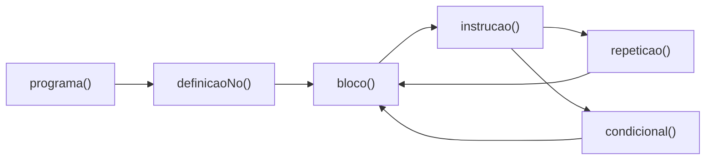

# Aula 11 aplicada à Amarra: autômatos de pilha

Esta etapa aplica os conceitos de **Aula11 - Automatos de pilha.pdf**, encontro
de 7 de outubro da disciplina Linguagens Formais e Compiladores, ao parser da
Amarra. A [Aula 10](aula10.md) introduziu a gramática e a árvore; aqui observamos
a análise enquanto ela acontece e acrescentamos ferramentas de depuração.

## Cada regra se torna um método

O ANTLR gera métodos de `AmarraParser` a partir das regras de
`gramatica/AmarraParser.g4`:

| Regra da gramática | Método gerado |
|---|---|
| `programa` | `AmarraParser.programa()` |
| `definicaoNo` | `AmarraParser.definicaoNo()` |
| `bloco` | `AmarraParser.bloco()` |
| `instrucao` | `AmarraParser.instrucao()` |
| `repeticao` | `AmarraParser.repeticao()` |
| `condicional` | `AmarraParser.condicional()` |
| `expr` | `AmarraParser.expr()` |

Ao analisar uma repetição, o parser chama uma regra de bloco dentro de outra
estrutura ainda em andamento. As chamadas e os contextos do ANTLR guardam onde
retomar a análise depois do bloco interno.



Esse mecanismo fornece a memória de aninhamento discutida na aula. A profundidade
depende da estrutura da entrada e das regras chamadas. Na implementação, ela
também está sujeita aos limites de memória e de recursão do Python.

## Observar a pilha durante a análise

A opção `--rastrear` registra os eventos do parser por meio de um
`ParseTreeListener`. O módulo `src/rastreamento.py` consulta
`getRuleInvocationStack()` e produz uma fotografia dos contextos a cada evento.
O reconhecimento continua sendo feito pelo parser gerado pelo ANTLR.

| Evento | Significado | Pilha exibida |
|---|---|---|
| `ENTRAR` | Uma regra/contexto começa a ser analisado. | Inclui o contexto que acabou de entrar. |
| `CONSUMIR` | O parser reconheceu um token da entrada. | Contextos associados ao token consumido. |
| `SAIR` | O parser encerra aquele contexto. | Contextos para os quais ele retorna. |

O rastro mostra os contextos **da base para o topo**, separados por `>`.
`pilha[n]` indica a quantidade de contextos. `lido` identifica o token consumido;
`proximo` mostra o token que o parser está olhando em uma entrada ou saída de
regra. As posições usam linha a partir de `1` e coluna a partir de `0`.

Para a expressão do exemplo `2 + 3 * (4 - 1)`, aparecem eventos como:

```text
ENTRAR   expr         proximo=NUMERO '2' @ 1:0 | pilha[1]: expr
CONSUMIR expr         lido=NUMERO '2' @ 1:0 | pilha[1]: expr
...
CONSUMIR expr         lido=NUMERO '4' @ 1:9 | pilha[4]: expr > expr > expr > expr
...
SAIR     expr         proximo=EOF '<EOF>' @ 2:0 | pilha[0]: (vazia)
```

O rastro é uma observação dos contextos do ANTLR, não uma listagem de todos os
quadros internos da pilha Python. Em `expr`, o gerador transforma a recursão à
esquerda e pode emitir saídas e novas entradas para construir a expressão. Por
isso, encerrar um contexto ou mostrar uma pilha vazia no meio do rastro não
significa que o arquivo inteiro foi aceito. A confirmação é a mensagem final de
sucesso, depois da verificação de toda a entrada.

Os eventos são emitidos durante a análise, inclusive antes de um erro sintático.
O rastro e os diagnósticos vão para a saída de erros (`stderr`); a mensagem de
sucesso e a árvore vão para a saída normal (`stdout`). Ambas aparecem no terminal.
Sem `--rastrear`, a saída continua sendo apenas o resultado da análise e a árvore.

## Padrões de repetição e opcionalidade

| Padrão da aula | Uso na Amarra |
|---|---|
| `x+` | `definicaoNo+`: um programa precisa ter pelo menos um nó. |
| `x*` | `instrucao*`: um bloco pode estar vazio ou conter várias instruções. |
| `x?` | `(SENAO bloco)?`: a alternativa da condicional é opcional. |
| `x (',' x)*` | Referência para uma futura construção com lista de argumentos. Os comandos atuais mantêm os argumentos definidos na especificação, sem lista por vírgulas. |

### Condicional com `senao`

```antlr
condicional : SE expr bloco (SENAO bloco)? ;
```

```amarra
no "reforco" {
    se voltas > 1 {
        enrolar ponta_esquerda 1;
    } senao {
        apertar;
    }
}
```

`senao` passa a ser uma palavra reservada. Ele deve vir imediatamente depois
do bloco de um `se`, seguido de outro bloco. Espaços e comentários podem aparecer
entre eles. As chaves são obrigatórias nos dois blocos e determinam a associação
de cada `senao`, mesmo quando há condicionais aninhadas. O exemplo
[`condicional_senao.amr`](../exemplos/condicional_senao.amr) demonstra essa situação.

Nesta fase, o parser reconhece os dois blocos: escolher qual executar depende
da avaliação da condição na futura etapa de execução.

## Recursão à esquerda e precedência

A Amarra continua usando alternativas como `expr op=(MAIS | MENOS) expr`.
Essa é recursão à esquerda direta: a regra aparece no início da própria produção.
O ANTLR 4 transforma as alternativas suportadas em uma implementação com controle
de precedência e iterações. O arquivo gerado contém chamadas a `precpred()` e
`pushNewRecursionContext()`, que participam desse mecanismo.

As alternativas-base de `expr`, como `NUMERO` e `IDENT`, permitem começar o
reconhecimento consumindo tokens. Somente uma regra como `expr : expr '+' expr ;`,
sem alternativa-base, não seria uma gramática de expressões completa.

As regras sintáticas ficam no parser e começam com minúscula. Se ocorrer um erro
de recursão à esquerda na geração, confira a regra envolvida, suas alternativas
base e possíveis ciclos entre regras. A transformação do ANTLR não cobre toda
forma de recursão indireta. Preserve a ordem de precedência definida na
[especificação](especificacao.md#5-operadores-e-precedência).

## Depurar uma regra por vez

Use `--regra` para selecionar uma das regras do parser. O padrão é `programa`,
que espera um programa completo. Exemplos de fragmentos:

| Regra | Entrada aceita |
|---|---|
| `expr` | `2 + 3 * (4 - 1)` |
| `bloco` | `{ apertar; }` |
| `instrucao` | `apertar;` |
| `comando` | `apertar` |
| `declaracao` | `inteiro voltas = 2` |
| `condicional` | `se verdadeiro {} senao {}` |

O `;` pertence à regra `instrucao`, por isso ele não faz parte do fragmento de
`comando` ou `declaracao`. A opção `--help` lista todas as regras disponíveis.
Os arquivos em `exemplos/fragmentos/` representam partes do programa e devem ser
analisados com a regra correspondente.

### Consumo completo e `EOF`

`programa` mantém o `EOF` na gramática. Para regras isoladas, `analisar()` confere
se o token seguinte ao resultado é `EOF`. Assim, `1 2` não é aceito como `expr`
apenas porque `1` é uma expressão válida. Um `;` após uma expressão isolada também
é reportado como texto excedente.

## Executar os exemplos

Na raiz do projeto, depois de instalar as dependências do README:

**Windows — PowerShell**

```powershell
.\.venv\Scripts\python.exe gerar.py
.\.venv\Scripts\python.exe src/sintatico.py exemplos/condicional_senao.amr
.\.venv\Scripts\python.exe src/sintatico.py exemplos/fragmentos/expressao.amr --regra expr --rastrear --formato lisp
.\.venv\Scripts\python.exe src/sintatico.py exemplos/fragmentos/bloco.amr --regra bloco --rastrear
.\.venv\Scripts\python.exe -m unittest discover -s tests -v
```

**Linux/macOS**

```bash
.venv/bin/python gerar.py
.venv/bin/python src/sintatico.py exemplos/condicional_senao.amr
.venv/bin/python src/sintatico.py exemplos/fragmentos/expressao.amr --regra expr --rastrear --formato lisp
.venv/bin/python src/sintatico.py exemplos/fragmentos/bloco.amr --regra bloco --rastrear
.venv/bin/python -m unittest discover -s tests -v
```

## Interpretar os erros

| Mensagem | Como investigar |
|---|---|
| `mismatched input ... expecting ...` | Compare o token encontrado com os símbolos esperados pela regra ativa. |
| `missing ')' at ';'` | A expressão entre parênteses chegou ao `;` antes do fechamento esperado. |
| `extraneous input ... expecting <EOF>` | A regra terminou e sobraram tokens; confira a entrada e a regra escolhida. |
| `Erro lexico` | O problema ocorreu no reconhecimento de caracteres, antes da análise sintática. |

[`parentese_sem_fechar.amr`](../exemplos/invalidos/sintaxe/parentese_sem_fechar.amr)
produz `Erro sintatico na linha 3, coluna 31: missing ')' at ';'`.
[`senao_sem_se.amr`](../exemplos/invalidos/sintaxe/senao_sem_se.amr) demonstra um
`senao` sem condicional correspondente. Em ambos os casos, o processo encerra
com código `1`, preservando o diagnóstico e sem imprimir uma árvore de sucesso.

Os testes verificam o vínculo de `senao`, o consumo completo nas regras isoladas,
as posições dos tokens no rastro, o aumento de profundidade com o aninhamento e
a preservação da árvore quando o rastreamento está ligado. Os testes de
precedência e dos exemplos anteriores continuam fazendo parte da suíte.
