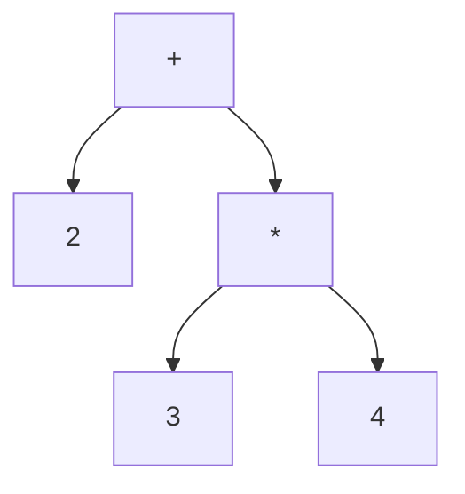

# Aula 13 aplicada à Amarra: erros e preparação para AST

Material de referência: **Aula13 - Erros e AST-1.pdf**, Encontro 13,
“O parser escrito à mão — E o que fazer quando o programa está errado”,
de 21/10/2026. Os números abaixo são os números impressos nos slides.

## O que mudou no projeto

| Conceito | Slides | Aplicação |
| :--- | :--- | :--- |
| Regras viram funções e chamadas | 2–4 | O projeto continua usando os métodos gerados pelo ANTLR a partir dos dois `.g4`. |
| Mensagem com onde, esperado e encontrado | 6–8 | [diagnosticos.py](../src/diagnosticos.py) usa os tokens e os símbolos esperados pelo parser. |
| Recuperação e redução de erros em cascata | 9–18 | [recuperacao.py](../src/recuperacao.py) acrescenta o modo pânico, ativado por `--recuperar`. |
| Árvore concreta e AST | 20–22 | A árvore concreta continua disponível; a comparação com uma AST está abaixo. |
| Listener e visitor | 23–32 | O listener observa a pilha; os testes demonstram o visitor devolvendo resultados. |
| Gerar com `-visitor` | 33–34 | [gerar.py](../gerar.py) agora sempre gera `AmarraParserVisitor.py`. |

O material anuncia a construção da AST para o Encontro 14. Esta atualização
prepara essa etapa, mantendo o escopo atual de análise léxica e sintática.
A apresentação de um parser escrito à mão serve para explicar o funcionamento;
não foi necessário substituir o parser gerado pelo ANTLR.

## Diagnósticos úteis

O diagnóstico contém a fase, a posição, os símbolos esperados e o que apareceu
no lugar. Exemplo de falta de ponto e vírgula:

```text
Erro sintatico na linha 4, coluna 4: esperava ';'; encontrou 'finalizar'
```

Os nomes de tokens são apresentados como `identificador`, `numero` e `texto
entre aspas`; os símbolos da linguagem aparecem como `';'`, `')'` e `'='`.
O fim da entrada aparece como `fim da entrada (EOF)`. As posições são fornecidas
pelo lexer: linha a partir de 1 e coluna a partir de 0.

A mensagem é construída a partir dos tokens e do conjunto esperado pelo ANTLR,
sem depender da tradução de uma frase de erro em inglês. Um erro léxico também
identifica o trecho que não pôde ser reconhecido:

```text
Erro lexico na linha 4, coluna 12: esperava um token valido; encontrou '@'
```

Na API Python, `ErroAnalise.diagnosticos` contém objetos com `fase`, `linha`,
`coluna`, `esperados` e `encontrado`. O texto da exceção reúne os diagnósticos
em linhas separadas. A CLI envia erros para `stderr` e encerra com código 1.

## Recuperação em modo pânico

Sem a opção `--recuperar`, a análise termina no primeiro erro, como nas versões
anteriores. Com a opção, uma falha dentro de uma instrução interrompe essa
instrução e devolve o controle ao bloco que a contém. O parser descarta o trecho
restante até um ponto de sincronização e tenta continuar.

| Token encontrado durante o descarte | Ação |
| :--- | :--- |
| `;` no nível da instrução | Consome o terminador e retoma na próxima instrução. |
| `}` do bloco chamador | Preserva a chave para o próprio bloco fazer seu fechamento. |
| `{` ou `}` dentro da instrução descartada | Balanceia o bloco para não confundir seu fechamento com o do bloco externo. |
| `+`, `*`, `(`, `)` e outros tokens | Continua descartando; não são pontos de sincronização. |
| `EOF` | Encerra a tentativa de recuperação. |

Isso evita tratar cada token de uma expressão defeituosa como um novo erro.
O descarte trabalha sobre tokens: um `;` dentro de um texto entre aspas não é
um terminador de instrução. Comentários já foram descartados pelo lexer.

A implementação herda do parser gerado e intercepta a saída da regra
`instrucao`. Uma estratégia de erro também trata tokens inválidos entre
instruções no bloco. A gramática continua sendo a fonte das regras de aceitação;
os arquivos de `gerado/` não recebem alterações manuais.

### Exemplo para apresentar

O arquivo [multiplos_erros.amr](../exemplos/invalidos/sintaxe/multiplos_erros.amr)
contém três instruções inválidas, intercaladas com comandos válidos:

```amarra
// A primeira expressao gera somente um diagnostico no modo panico.
no "recuperacao" {
    inteiro voltas = 1 + ) * ( + 2 * ) + 3;
    apertar;
    cruzar ponta_direita;
    passar_cima ponta_esquerda;
    finalizar;
}
```

No Windows, a partir da raiz do projeto:

```powershell
.\.venv\Scripts\python.exe gerar.py
.\.venv\Scripts\python.exe src/sintatico.py exemplos/invalidos/sintaxe/multiplos_erros.amr --recuperar
```

No Linux/macOS:

```bash
.venv/bin/python gerar.py
.venv/bin/python src/sintatico.py exemplos/invalidos/sintaxe/multiplos_erros.amr --recuperar
```

O resultado tem três diagnósticos:

| Linha | Coluna | Problema |
| ---: | ---: | :--- |
| 3 | 25 | Encontrou `)` onde deveria começar um operando. |
| 5 | 24 | Faltou o segundo identificador do comando `cruzar`. |
| 7 | 13 | Faltou a expressão do comando `finalizar`. |

O parser reconhece também os comandos válidos das linhas 4 e 6. A opção
`--rastrear` permite acompanhar esse consumo. A CLI termina com código 1 e não
imprime árvore nem mensagem de sucesso. Removendo `--recuperar`, aparece somente
o diagnóstico da linha 3.

### Limites da recuperação

A estratégia tenta descobrir outros problemas, mas não garante relatar todos.
Uma chave ausente, um cabeçalho de nó inválido ou um erro fora de uma instrução
pode impedir a continuação. Se faltar `;`, parte da instrução seguinte pode ser
descartada até encontrar outro delimitador seguro.

Regras isoladas continuam disponíveis com `--regra`. A recuperação ocorre nos
limites de instruções e blocos; uma expressão isolada sem esses limites termina
no primeiro erro sintático. O consumo completo até `EOF` continua obrigatório.

Com `--recuperar`, o lexer coleta seus erros antes do parser. Havendo qualquer
erro léxico, a fase sintática não é iniciada: isso evita diagnósticos sintáticos
causados apenas pelos caracteres que o lexer descartou. Qualquer diagnóstico
impede a devolução de uma árvore de sucesso, mesmo após recuperação.

## Árvore concreta e AST

Para `2 + 3 * 4`, a árvore concreta mantém contextos `expr` e tokens. Uma AST
pode guardar apenas a estrutura da operação:



A precedência permanece representada: a multiplicação é filha da soma.
Parênteses usados para agrupamento não precisam ser nós da AST, pois seu efeito
já está na organização dos filhos. A quantidade de nós da árvore concreta
depende da gramática; os números mostrados nos slides não são uma contagem da Amarra.

Essa figura explica o conceito. A saída atual de `src/sintatico.py` continua
sendo uma árvore concreta. Ainda não há uma AST completa da linguagem nem
verificação de tipos, tabela de símbolos ou execução dos movimentos.

## Listener e visitor

O [RastreadorPilha](../src/rastreamento.py) usa um listener para observar entradas
e saídas de regras e consumo de tokens. Um visitor permite que cada visita
devolva um resultado para a visita que a chamou, o que será útil para montar
a AST e verificar tipos de subexpressões.

O script de geração passou a usar `-visitor`. O comando simplificado mostrado
na aula é `antlr4 -Dlanguage=Python3 -visitor Sua.g4`; `Sua.g4` é um nome de exemplo.
No projeto, `gerar.py` aplica a opção às gramáticas Amarra, mantém a versão 4.13.2
e coloca os resultados em `gerado/`.

Não é necessário criar outro `.g4`. A geração cria
`gerado/AmarraParserVisitor.py`, com métodos como `visitPrograma`,
`visitDeclaracao`, `visitAditiva` e `visitMultiplicativa`. Como `expr` possui
alternativas rotuladas com `#`, suas visitas recebem os nomes dessas alternativas.

O visitor padrão apenas visita os filhos. Para acrescentar comportamento,
crie uma subclasse em um arquivo próprio; a geração sobrescreve os arquivos
de `gerado/`. O teste `test_visitor_devolve_resultados_das_subexpressoes`, em
[test_diagnosticos_recuperacao_visitor.py](../tests/test_diagnosticos_recuperacao_visitor.py), demonstra esse contrato retornando
`('+', '2', ('*', '3', '4'))` para a expressão usada na aula. Esse exemplo do
teste não é uma implementação completa da AST da linguagem.

## Validação

Na execução de **21/10/2026**, após regenerar os analisadores:

```powershell
.\.venv\Scripts\python.exe -m unittest discover -s tests -v
```

```text
Ran 132 tests in 5.687s

OK
```

| Conjunto | Quantidade |
| :--- | ---: |
| Testes anteriores das Aulas 10 e 11 e coleção de entradas | 108 |
| Diagnósticos: posição, símbolos esperados e entrada encontrada | 6 |
| Recuperação: cascatas, aninhamento, EOF, tokens inválidos, léxico e progressão | 12 |
| Visitor: retorno de resultados e percurso dos comandos | 2 |
| Terminal: sucesso, falha, modo padrão e recuperação | 4 |
| **Total** | **132** |

Um dos testes novos percorre as 72 entradas da coleção com recuperação ativada,
conferindo a aceitação/rejeição e a preservação das árvores válidas. Esses
subtestes não são somados como 72 testes independentes adicionais. Outro teste
verifica o avanço por 100 instruções inválidas sem travar.

Os resultados foram obtidos no Windows, com Python 3.11.2 e ANTLR 4.13.2.
O [relatório anterior](validacao-sintatica.md) preserva a validação de 20/10.
