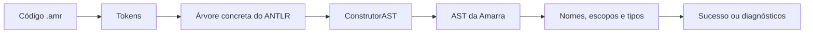

# Aula 14 aplicada à Amarra: AST, símbolos e regras semânticas

Material de referência: **Aula14 - Construindo a AST-1.pdf**, Encontro 14,
“O erro que o parser deixa passar — Construindo a AST e a tabela de símbolos”,
de 28/10. Implementação no projeto em **04/11/2026**. Os números abaixo são
os números impressos nos slides; o PDF repete páginas para revelar os tópicos.

Esta página registra a entrega da AST e da análise semântica. A evolução
posterior com execução e animação está em [interface-visual.md](interface-visual.md).

## Relação com a aula

| Conceito | Slides | Implementação |
| :--- | :--- | :--- |
| A sintaxe aceita um nome que não existe | 3–5 | O parser aceita `z = x + y * 2;`; a fase semântica rejeita o destino `z` não declarado. |
| AST com nós que representam ações | 9–11 | [arvore_abstrata.py](../src/arvore_abstrata.py) define `NoAST`, seus campos e filhos. |
| Visitor devolve nós próprios | 13–16 | [construtor_ast.py](../src/construtor_ast.py) herda do visitor gerado e implementa as visitas da Amarra. |
| Tabela de símbolos | 18 | [semantico.py](../src/semantico.py) registra nome, tipo, posição e escopo das variáveis. |
| Uso de nome não declarado | 19 | Verifica tanto referências `Var` quanto o destino `Atribui`. |
| Declaração repetida | 20 | Consulta o bloco atual antes de registrar uma variável; preserva a primeira declaração. |
| Blocos exigem pilha de tabelas | 21 | Entra e sai de escopos, buscando nomes do bloco interno para o externo. |

O material antecipa a pilha de escopos como assunto do Encontro 15. Ela já foi
adotada aqui porque a Amarra possui `se`, `senao` e `repetir` aninhados. O PDF
também anuncia a compatibilidade de tipos na E4. As decisões específicas de
tipos abaixo foram definidas para a Amarra ao atender ao pedido de regras
semânticas; não são uma transcrição de regras detalhadas fornecidas pelo slide.

## Caminho da análise



A fase semântica começa apenas depois de toda a entrada passar pela análise
léxica e sintática. Mesmo com `--recuperar`, erros nessas fases impedem a criação
da AST. Na API, `construir_ast(codigo)` devolve um `NoAST` e
`analisar_semantica(codigo)` devolve `ResultadoSemantico(ast, simbolos)` em sucesso.
Ambas lançam `ErroAnalise` quando há erros de análise.

## Estrutura da AST

Cada nó tem `classe`, `campos`, `linha` e `coluna`. `filhos()` percorre seus nós
filhos e `para_dict()` permite exportar JSON sem objetos do ANTLR.

| Classe | Campos principais |
| :--- | :--- |
| `Programa` | Lista de `definicoes`. |
| `DefinicaoNo` | `nome` do nó e `corpo`. |
| `Bloco` | Lista de `instrucoes`. |
| `Declara` | `tipo`, `nome` e `valor` inicial. |
| `Atribui` | `nome` do destino e `valor`. |
| `Comando` | `nome`, lista de `pontas` e `valor` quando aplicável. |
| `Ponta` | Nome simbólico de uma ponta, separado das referências a variáveis. |
| `Repetir` | `quantidade` e `corpo`. |
| `Se` | `condicao`, bloco `entao` e bloco `senao` opcional. |
| `Op` | `operador`, expressão `esquerda` e expressão `direita`. |
| `Unario` | `operador` e `valor`. |
| `Num` | Grafia exata em `valor` e `tipo` (`inteiro` ou `real`). |
| `Texto`, `Booleano` | `valor` do literal. |
| `Var` | `nome` da variável referenciada. |

Os números mantêm sua grafia como string, evitando arredondar valores reais
antes da futura execução. Textos perdem apenas as aspas delimitadoras; a
gramática atual não interpreta sequências de escape. Booleanos usam `True` e
`False` na representação Python.

Os nós de pontuação, `EOF`, `instrucao` e agrupamento desaparecem. A precedência
e o efeito dos parênteses permanecem na organização dos filhos. Por exemplo:

```text
Op operador='+'
  esquerda: Var nome='x'
  direita: Op operador='*'
    esquerda: Var nome='y'
    direita: Num valor='2' tipo='inteiro'
```

No exemplo de três instruções da aula, a AST da Amarra possui 13 nós: os 11 da
estrutura ilustrada no material mais `DefinicaoNo` e `Bloco`, exigidos pela nossa
linguagem. A contagem da árvore concreta depende da gramática utilizada.

## Tabela de símbolos e escopos

Cada bloco cria uma tabela. Ao sair dele, a tabela deixa de participar das
buscas. A saída `--simbolos` apresenta um registro das declarações analisadas,
incluindo as dos blocos já encerrados, com um identificador de escopo.

- Um nome deve ser declarado antes do uso, inclusive no destino de `=`.
- O mesmo nome não pode ser declarado duas vezes no mesmo bloco.
- Um bloco interno pode declarar um nome igual ao externo (sombreamento).
- O inicializador é analisado antes de inserir a nova variável. Assim,
  `inteiro x = x + 1;` exige uma declaração anterior visível de `x`.
- Declarações em um `se`, `senao` ou `repetir` não vazam para o bloco externo.
- Os dois ramos de uma condicional têm escopos independentes.
- Cada definição de nó possui seu próprio escopo; não há variáveis globais.

Os nomes das pontas são referências simbólicas dos comandos de movimento.
`cruzar a b;` não exige declarar variáveis `a` e `b`. Em `enrolar a voltas;`,
`a` é uma ponta e `voltas` é uma expressão que exige variável declarada.
A linguagem ainda não tem declaração de objetos do tipo ponta nem validação
de sua existência física. Essa distinção preserva os exemplos existentes.

## Regras de tipos

| Construção | Regra |
| :--- | :--- |
| Declaração e atribuição | Tipos iguais; também permite atribuir `inteiro` a `real`. |
| `+`, `-`, `*` | Dois números; resultado `real` se algum operando for real, senão `inteiro`. |
| `/` | Dois números; resultado sempre `real`, mesmo em `4 / 2`. |
| `-` unário | Número; mantém o tipo do operando. |
| `>`, `<` | Dois números; resultado `booleano`. |
| `==` | Tipos iguais ou dois tipos numéricos; resultado `booleano`. |
| `e`, `ou` | Dois booleanos; resultado `booleano`. |
| Condição de `se` | `booleano`. |
| Quantidade de `repetir` e de `enrolar` | `inteiro`. |
| Argumento de `finalizar` | `texto`. |

Não há conversão implícita de texto para número, de real para inteiro ou de
número para booleano. `+` é soma numérica; não concatena textos.

## Diagnósticos

| Código | Significado |
| :--- | :--- |
| `S001` | Variável sem declaração anterior visível. |
| `S002` | Declaração repetida no mesmo bloco. |
| `S003` | Tipo incompatível em declaração ou atribuição. |
| `S004` | Tipo inadequado para condição, repetição ou comando. |
| `S005` | Operador aplicado a tipos incompatíveis. |

Todos contêm `fase`, `codigo`, `linha`, `coluna` e `mensagem`. Linhas começam
em 1 e colunas em 0. A análise reúne erros independentes; uma expressão com
erro propaga tipo desconhecido para evitar uma sequência de erros derivados.
Declarações com inicializador inválido ainda registram o tipo declarado para
reduzir cascatas, mas qualquer diagnóstico rejeita o programa.

## Demonstração no terminal

Execute na raiz do projeto, depois de instalar as dependências e executar
`gerar.py`, conforme o [README](../README.md). Não há novas dependências ou `.g4`.

```powershell
# Exibir somente a AST (não verifica tipos ou nomes)
.\.venv\Scripts\python.exe src/construtor_ast.py exemplos/escopos.amr

# Exportar a AST de uma expressão como JSON
.\.venv\Scripts\python.exe src/construtor_ast.py exemplos/fragmentos/expressao.amr --regra expr --formato json

# Verificar a semântica e mostrar a AST e a tabela de símbolos
.\.venv\Scripts\python.exe src/semantico.py exemplos/escopos.amr --ast --simbolos

# Reproduzir o problema de z usado sem declaração
.\.venv\Scripts\python.exe src/semantico.py exemplos/invalidos/semantica/variavel_nao_declarada.amr
```

No último comando, o resultado esperado é:

```text
Erro semantico na linha 5, coluna 4 [S001]: variavel 'z' usada sem declaracao anterior neste escopo.
```

No Linux/macOS, substitua o executável por `.venv/bin/python`. Erros vão para
`stderr`, com código de saída 1 e sem árvore ou tabela de sucesso. A CLI da AST
aceita `--regra programa`, `bloco` ou `expr`; a CLI semântica exige um programa
completo. `--recuperar` controla a recuperação sintática; os erros semânticos
independentes já são coletados por padrão.

## Validação e limites

Em 04/11/2026, **224 testes passaram**: 132 anteriores, 15 de AST, 62 casos
semânticos (23 válidos e 39 inválidos) e 15 de API/terminal semântico. A matriz
de entradas está no [relatório de validação semântica](validacao-semantica.md).

Esta etapa é uma análise estática: visita os dois ramos de `se` e cada corpo de
`repetir` uma vez, sem executar o programa. Não verifica divisão por zero,
quantidades negativas, existência de `finalizar` em todos os caminhos ou a
sequência física dos movimentos. A execução e o tutorial visual continuam
como próximas etapas. A aceitação semântica não garante um nó fisicamente válido.
