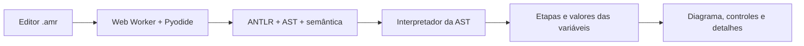

# Interface visual: do código ao nó

A aplicação web oferece um editor Amarra e um diagrama animado com duas pontas
de cadarço. O código é analisado e executado no navegador, utilizando o mesmo
compilador Python do projeto. A hospedagem escolhida é o GitHub Pages.

**Acesso:** [Amarra online](https://linguagem-amarra.github.io/amarra-lang/).

## Como usar

1. Escolha **Nó inicial do cadarço** e clique em **Analisar e montar**.
2. Clique em **Reproduzir** ou avance uma etapa por vez. A linha correspondente
   fica destacada no editor; cada etapa também possui uma explicação.
3. Use **Anterior** ou **Reiniciar** para rever movimentos. Pausar interrompe
   o avanço automático; a transição visual já iniciada termina na etapa atual.
4. No exemplo **Uma volta a mais**, troque `voltas = 2` por `voltas = 3` e
   analise novamente. O roteiro cresce de seis para sete etapas.
5. O exemplo **Escolha com uma condição** permite trocar `verdadeiro` por
   `falso` para observar a escolha entre os ramos.
6. O exemplo **Encontre o erro** demonstra um tipo incompatível. Clique no
   diagnóstico para selecionar a linha que precisa ser corrigida.

As abas mostram tokens, AST, tabela de símbolos e valores das variáveis na
etapa atual. **Abrir arquivo** importa um `.amr`; **Salvar** baixa o texto do
editor. O rascunho é guardado no armazenamento local do navegador quando ele
está disponível. Editar o código invalida o roteiro anterior até a nova análise.
O atalho **Ctrl+Enter** (ou **Cmd+Enter**) analisa o programa.

O arquivo [cadarco_visual.amr](../exemplos/cadarco_visual.amr) contém um exemplo
para importar. Programas com várias definições de nó recebem um seletor de nó.

## Arquitetura e execução



- `src/interpretador.py` avalia a AST validada, com escopos, atribuições,
  expressões, `se/senao` e `repetir`. Operadores `e` e `ou` usam curto-circuito.
- Cada volta de `enrolar` vira uma etapa; quantidade zero produz zero etapas.
- `finalizar` registra a mensagem e encerra a definição de nó atual, inclusive
  quando aparece dentro de blocos. Outras definições continuam independentes.
- Cada etapa contém posição no código, pontas, comando e uma cópia dos valores
  das variáveis visíveis. Voltar etapas usa esses registros, sem reexecutar.
- `src/interface_web.py` expõe o contrato JSON para o worker e para os testes.
- `web/compilador.worker.js` carrega Pyodide **314.0.7** e o pacote local do
  compilador. O texto Amarra é passado como dado para uma função Python;
  não é executado com `eval` ou `exec`.
- `web/movimentos.js` calcula os estados visuais; `web/cena.js` interpola curvas
  e usa profundidade local para desenhar os trechos por cima e por baixo.

A execução fica em um worker para manter a tela responsiva. A primeira abertura
baixa o ambiente Python da CDN do Pyodide; uma falha de carregamento apresenta
um botão para tentar novamente. O código do usuário é processado localmente,
sem ser enviado a um servidor de análise.

## Limites e diagnósticos de execução

| Código | Situação |
| :--- | :--- |
| `E001` | Divisão por zero em uma expressão realmente executada. |
| `E002` | Quantidade negativa em `repetir` ou `enrolar`. |
| `E003` | Limite de 300 etapas ou 20.000 operações atingido. |
| `E004` | Número excede a faixa da demonstração ou resultado real não é finito. |
| `E005` | Tentativa de cruzar uma ponta com ela mesma. |

A entrada admite até 20.000 caracteres. O navegador também encerra uma análise
que ultrapasse 15 segundos. Em erro, não publica um roteiro parcial. As análises
léxica, sintática e semântica continuam sendo pré-requisitos da execução.

O desenho é didático e acompanha **duas pontas**. Um programa com mais pontas
continua exibindo o roteiro e os detalhes, mas informa o limite e desativa o
player. Sem cruzamento anterior, os movimentos dependentes dele mostram um
aviso. Até seis voltas são desenhadas como curvas distintas; a contagem e as
etapas continuam mostrando todas as voltas dentro do limite de execução.

Não há simulação de tensão, atrito ou garantia de correção física de uma
sequência arbitrária. A demonstração inicial representa a **base do cadarço**,
antes das alças que completam o laço. A sequência de referência é a etapa
inicial do [Shoelace Bow, de Animated Knots](https://www.animatedknots.com/shoelace-bow-knot).
As ilustrações desta aplicação foram desenhadas para o projeto.

## Testar localmente

Depois de instalar as dependências e gerar os analisadores, conforme o README:

```powershell
cd web/studio
$env:VITE_STUDIO_STATIC='true'
npm ci
npm run build
cd ../..
.\.venv\Scripts\python.exe scripts/construir_web.py
.\.venv\Scripts\python.exe -m http.server 8000 --bind 127.0.0.1 --directory dist
```

Abra `http://127.0.0.1:8000/classico/` para a interface 2D; a raiz abre o
Studio 3D. No Linux/macOS, use `.venv/bin/python` e defina
`VITE_STUDIO_STATIC=true` antes do build. A pasta
`dist/` é gerada e ignorada pelo Git. Não abra `index.html` diretamente pelo
explorador: o worker e o pacote Python precisam ser servidos por HTTP.

## Publicação

O workflow [.github/workflows/publicar-interface.yml](../.github/workflows/publicar-interface.yml)
instala Python, Java e Node, gera os analisadores, executa os testes e monta
`dist/`. O GitHub Pages publica o Studio 3D na raiz e a interface 2D em
`/classico/`. O Studio compila programas no navegador com Pyodide, sem servidor
Python. O site completo fica no artefato `site-amarra` da execução. Em
**Settings → Pages**, a origem deve ser **GitHub Actions**. O workflow atende à
`main` e à branch `codex/interface-visual-nos`; depois da integração, a `main`
pode ser a única branch de publicação. Nenhuma chave ou credencial é armazenada
no projeto.

O resultado é uma aplicação estática, compatível também com hospedagem estática
na Vercel. Nesse caso, construa `dist/` primeiro e publique seu conteúdo; a
configuração automática entregue nesta versão é a do GitHub Pages.

## Verificação

Em 04/11/2026, a suíte Python passou com **244 testes**. Os 20 novos verificam
execução, escopos, curto-circuito, finalização, limites e o contrato da interface.
`node tests/test_movimentos.mjs` verifica os estados visuais e o retorno às etapas.
Node é necessário apenas para esse teste adicional, não para usar a interface.

Também foram verificados no Chrome: carregamento real do Python no navegador,
etapas, reprodução/pausa, alteração de duas para três voltas, `se/senao`, abas,
diagnósticos clicáveis, importação/download de arquivo, várias definições de nó
e layout de celular sem rolagem horizontal.

Referências técnicas: [GitHub Pages](https://docs.github.com/en/pages/getting-started-with-github-pages/what-is-github-pages),
[Pyodide em worker](https://pyodide.org/en/stable/usage/webworker.html) e
[código Python empacotado](https://pyodide.org/en/stable/usage/loading-custom-python-code.html).
O runtime ANTLR empacotado acompanha seu [aviso de licença](../web/ANTLR-LICENSE.txt).
